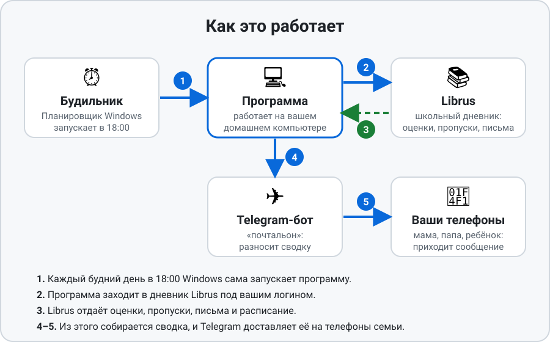

# Librus → Telegram digest

A small bot that runs **on your own computer**, logs in to **Librus Synergia** (the Polish
school e-register) and sends a clean **daily summary to Telegram**: grades, absences,
messages and school announcements, what is coming up (tests, homework, days off) and when
school starts next. Several students and several recipients are supported.

**Русская версия для новичков: [README.ru.md](README.ru.md)** — пошагово, с нуля.

> **Unofficial project.** Not affiliated with or endorsed by Librus / Synergia. See
> [How it works and legal notes](#how-it-works-and-legal-notes) before using it.

<p align="center">
  
</p>

**Run it at home, not in the cloud.** Librus often drops connections from data-centre
addresses (GitHub Actions runners included). From a normal home connection it works.

## Sample output

```
Digest · Friday, November 6

ANNA

📝 Grades
🟡 3  Chemistry
      quiz, weight 1
      Chemical bonds - summary
🔵 4  Physics
      homework, weight 1

Average
Chemistry: 4,10 → 4,00
Physics: 3,50 → 3,64

🚫 Absences and lateness
✅ None today

✉️ Messages
Library open
Smith John (teacher), 2026-11-06 08:23
│ Dear students and parents, the library reopens in a new place…

📅 Coming up
Tue 10.11  🔴 Chemistry — test, lesson 6
    covalent, ionic and metallic bonds
Wed 11.11  day off: Independence Day

🏫 School
No school tomorrow.
Next school day — Monday 09.11: from 08:50 to 15:50, 8 lessons
First lesson: #2, Safety at work
```

Colour dots: 🟢 5–6, 🔵 4, 🟡 3, 🔴 1–2, ⚪ non-numeric. Upcoming: 🔴 test / exam,
🟡 quiz.

## Features

- **Grades** with the teacher's comment, plus how the weighted **average** changed.
- **Absences and lateness** — always shown, with an explicit "none" when all is fine.
- **Messages** with a preview (first 100 words) and **school announcements**.
- **Coming up**: tests, quizzes, homework and days off for the next 10 days.
- **Next school day**: start, end and number of lessons; skips weekends and holidays.
- **Forgiving schedule**: retries every 20 minutes, never sends twice, catches up after
  the computer was off.
- English and Russian output; one broken Librus page never kills the whole digest.

## Quick start on Windows (no command line)

1. Create a bot with [@BotFather](https://t.me/BotFather) (`/newbot`) and keep the
   token. Every recipient presses **Start** on your bot and gets their numeric id from
   [@userinfobot](https://t.me/userinfobot).
2. Install [Python 3.10+](https://www.python.org/downloads/), ticking
   **Add python.exe to PATH**.
3. **Code → Download ZIP** on this page and unpack it to a permanent folder.
4. In the `windows` folder double-click, in order:

| File | What it does |
|---|---|
| `1-setup.bat` | Creates `.venv`, installs libraries, creates `.env` and opens it for editing |
| `2-test.bat` | Reads Librus and shows a preview in Notepad; sends nothing |
| `3-send-now.bat` | Sends today's digest to Telegram |
| `4-schedule.bat` | Creates the Windows scheduled task (asks for the time, default 18:00, Mon–Fri) |
| `5-remove-schedule.bat` | Removes the task |

The scheduled task runs without a console window and writes to `librus-digest.log`.
If you move the folder, delete `.venv` and run steps 1 and 4 again.

## Linux and macOS

```bash
git clone https://github.com/k30medvedev/librus-telegram-digest.git
cd librus-telegram-digest
python3 -m venv .venv && .venv/bin/pip install -r requirements.txt
cp .env.example .env                              # then edit .env
.venv/bin/python -m librus_digest --dry-run       # preview
```

Add to `crontab -e` (every 20 minutes from 18:00, Monday–Friday; sends once):

```
*/20 18-23 * * 1-5 cd /path/to/librus-telegram-digest && .venv/bin/python -m librus_digest --once-per-day --report-after 18:00 --log-file librus-digest.log
```

## Configuration

Settings are environment variables; a `.env` file in the working folder is read
automatically.

| Variable | Required | Description |
|---|---|---|
| `TELEGRAM_BOT_TOKEN` | yes | Token from @BotFather |
| `TELEGRAM_CHAT_ID` | yes | One or more chat ids, comma separated (a group id works too) |
| `LIBRUS_1_LOGIN`, `LIBRUS_1_PASSWORD` | yes | Synergia login (numeric) and password of the first student |
| `LIBRUS_1_NAME` | no | Display name (default `Student 1`) |
| `LIBRUS_2_*`, `LIBRUS_3_*`, … | no | More students; numbering must have no gaps |
| `DIGEST_LANGUAGE` | no | `ru` (default) or `en` |

Command line:

| Option | Meaning |
|---|---|
| `--dry-run` | Print the digest instead of sending it |
| `--once-per-day` | Skip if this day's digest was already delivered (safe to retry) |
| `--report-after HH:MM` | Your scheduled time. An earlier run is a catch-up: it reports the previous weekday and does not block today's digest. Missed days are included (up to 7) |
| `--log-file PATH` | Write the log to a file (for runs without a console) |
| `--language en\|ru`, `--env-file PATH`, `--version` | |

## Optional: GitHub Actions

The repository contains a manual workflow (`.github/workflows/digest.yml`) that reads the
same settings from repository secrets and variables. **It is not the recommended way**:
Librus often does not answer GitHub's servers, so runs time out and the digest reports an
error. If you try it, use a private repository and trigger it with the
`workflow_dispatch` API from an external scheduler.

## Development

```bash
pip install -r requirements-dev.txt
python -m pytest
```

```
librus_digest/
  client.py    # the ONLY module that talks to Librus (adapter over librus-apix)
  models.py    # plain dataclasses: Grade, Attendance, Message, ...
  stats.py     # weighted averages
  render.py    # data -> Telegram HTML (pure, no network, no clock)
  i18n.py      # UI strings (en, ru) — add a language here
  digest.py    # orchestration: what goes into the digest, time-outs, catch-up window
  telegram.py  # message splitting and sending with retries
  config.py    # env / .env / recipients
  cli.py       # python -m librus_digest
windows/       # double-click setup, preview, send and scheduling scripts
tests/         # pytest, no network: Librus is replaced by a fake session
```

## How it works and legal notes

**This is a scraper, not an API client.** Librus offers no public API for parents and
students. The bot uses [`librus-apix`](https://github.com/poroknights/librus-apix) (MIT),
an unofficial library that logs in with your own credentials and parses the same web
pages you see in the browser. Consequences:

- It can **break without notice** whenever Librus changes its pages or login flow.
- Librus' terms of service may restrict automated access. **Read the terms that apply to
  your school/account yourself** — this README is not legal advice and the authors have
  not verified them.
- Be a good citizen: the bot logs in **once per run, once a day**, and only reads data.
  It never writes, sends or changes anything in Librus. Don't schedule it aggressively.

**Privacy.**

- Use it only for **your own account or your own children's** accounts. Don't run it as a
  service that stores other people's Librus passwords.
- Grades, absences and messages of minors are personal data. The digest is sent through
  Telegram (a third-party cloud service) to the chats you configure — keep the recipient
  list tight, and protect the computer that holds your `.env` file.
- Credentials live in your local `.env` file (or environment variables) only. They are never logged
  (passwords are excluded from object representations, the Telegram token is not written
  to logs), and `.env` is git-ignored.

**Known behaviour to be aware of.**

- Opening a message to preview it **marks it as read** in Librus.
- A digest shows items **dated** the reported day (plus any days missed since the last
  delivery). Something a teacher enters after that day's digest was sent, or enters late
  for an earlier date, will not appear. Absences show up once a teacher records them.
- Subject names, comments and messages stay in their original language (Polish).
- The weighted average is computed by the bot (`+` = +0.5, `−` = −0.25) and may differ
  slightly from the school's official calculation.

## Credits

- [librus-apix](https://github.com/poroknights/librus-apix) — the scraping library doing
  the heavy lifting (MIT).

## License

[MIT](LICENSE)
