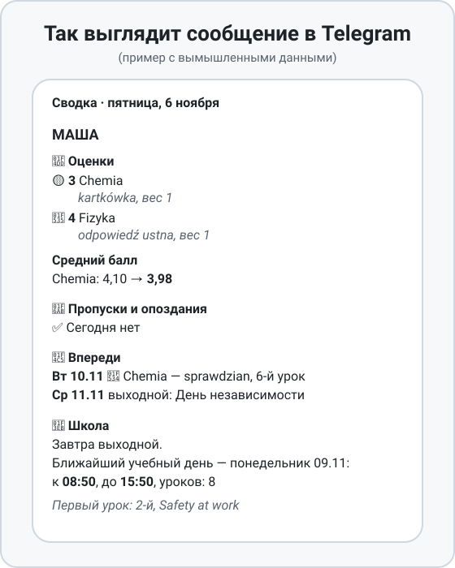
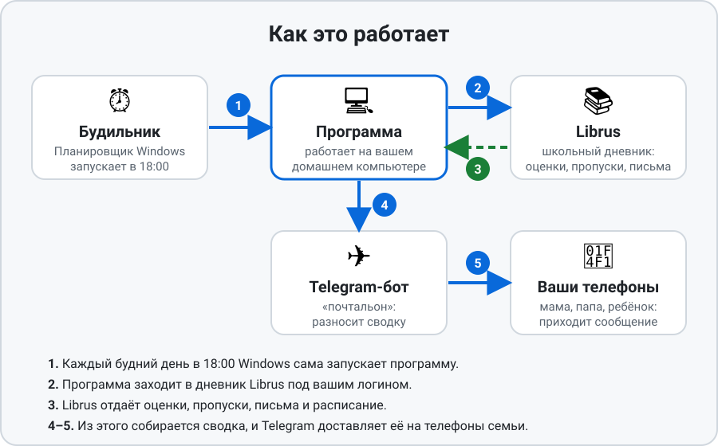

# Сводка из Librus в Telegram — на вашем домашнем компьютере

Инструкция для тех, кто никогда ничего подобного не делал. Программировать не нужно:
скачать, заполнить один файл и несколько раз щёлкнуть мышкой. Займёт **20–30 минут**,
один раз.

**Что вы получите.** По будням в 18:00 в Telegram приходит сообщение: оценки за день,
пропуски, письма учителей, ближайшие контрольные и выходные, во сколько завтра в школу.
Можно подключить несколько детей и несколько получателей (мама, папа, ребёнок).

<p align="center">
  
</p>

## Как это работает

<p align="center">
  
</p>

Всё происходит **на вашем компьютере**. Ваши пароли никуда не передаются, кроме самого
Librus. Почему не «в облаке»? Librus часто не отвечает серверам из интернета, а с
домашнего компьютера работает надёжно.

## Что понадобится

- Компьютер с **Windows 10 или 11**, который обычно **включён в 18:00**. Если он был
  выключен, сводка придёт, когда вы его включите.
- Логин и пароль **Librus Synergia** каждого ребёнка (логин из цифр, например `1234567`).
- Telegram на телефоне.
- Всё бесплатно.

> **Важно знать.** Это неофициальная программа, к Librus она отношения не имеет. Она
> заходит в дневник под вашим логином и **читает** его (единственное изменение: открытые
> ею письма становятся прочитанными). Пользуйтесь только для своей семьи. Правила
> Librus об автоматическом доступе проверьте сами.

---

## Шаг 1. Создайте Telegram-бота

1. В Telegram найдите **@BotFather** (с синей галочкой) и нажмите **Start**.
2. Отправьте `/newbot`.
3. Придумайте название (например, `Школа`) и имя, которое заканчивается на `bot`
   (например, `MoiShkolaDnevnik_bot`).
4. BotFather пришлёт **токен** вида `123456789:AAH...`. Скопируйте его в заметки. Это
   пароль от бота, никому его не показывайте.
5. Откройте своего бота по ссылке из ответа и нажмите **Start**.
   **Каждый получатель должен один раз нажать Start**, иначе бот не сможет ему писать.

## Шаг 2. Узнайте номер чата

1. В Telegram найдите **@userinfobot** и нажмите Start.
2. Запишите число из строки **Id**, например `123456789`.
3. Повторите для каждого получателя.

## Шаг 3. Установите Python

Python — бесплатная программа, на которой работает бот.

1. Откройте <https://www.python.org/downloads/> и нажмите большую жёлтую кнопку
   **Download Python**.
2. Запустите скачанный файл. **Обязательно поставьте галочку `Add python.exe to PATH`**
   внизу первого окна, затем нажмите **Install Now**.

## Шаг 4. Скачайте программу

1. Откройте <https://github.com/k30medvedev/librus-telegram-digest>.
2. Зелёная кнопка **Code** → **Download ZIP**.
3. Распакуйте архив (правой кнопкой → **Извлечь всё**) в постоянное место, например
   `C:\librus-digest`. Потом эту папку **не переносите и не удаляйте**.

## Шаг 5. Настройка

1. Откройте в папке программы папку **`windows`**.
2. Дважды щёлкните **`1-setup.bat`**.
   - Windows может предупредить, что файл скачан из интернета. Убедитесь, что вы скачали
     его именно со страницы из шага 4. Любой такой файл можно открыть Блокнотом и
     посмотреть, что в нём. Затем: **Подробнее → Выполнить в любом случае**.
3. Подождите 1–2 минуты. Откроется Блокнот с файлом настроек **`.env`**.
4. Впишите свои данные после знаков `=` (без пробелов и кавычек):

```ini
TELEGRAM_BOT_TOKEN=123456789:AAH_ваш_токен
TELEGRAM_CHAT_ID=123456789,987654321
LIBRUS_1_NAME=Маша
LIBRUS_1_LOGIN=1234567
LIBRUS_1_PASSWORD=пароль_от_Librus
DIGEST_LANGUAGE=ru
```

   - Несколько получателей — номера **через запятую**.
   - Второй ребёнок: уберите `#` в начале строк `LIBRUS_2_...` и заполните их.
5. Сохраните: **Ctrl + S**, закройте Блокнот.

> Файл `.env` содержит ваши пароли. Никому его не отправляйте.

## Шаг 6. Проверка без отправки

Дважды щёлкните **`2-test.bat`**. Через минуту в Блокноте откроется предпросмотр
сводки. В Telegram ничего не отправляется (но письма за сегодня отметятся в Librus как
прочитанные).

## Шаг 7. Первое настоящее сообщение

Дважды щёлкните **`3-send-now.bat`**. Сводка должна прийти всем получателям в Telegram.

## Шаг 8. Ежедневное расписание

Дважды щёлкните **`4-schedule.bat`**, нажмите **Enter** (будет 18:00) или напишите своё
время, например `19:30`.

**Готово!** Больше ничего делать не нужно.

---

## Как это ведёт себя дальше

- Сводка приходит **с понедельника по пятницу** в выбранное время. Чёрное окно не
  появляется, программа работает незаметно.
- Если в этот момент не было интернета, программа пробует снова каждые 20 минут до
  полуночи. Дважды одно и то же не придёт.
- Если компьютер был **выключен**, сводка за пропущенный день придёт через пару минут
  после входа в Windows (пропущенные дни объединяются, не больше 7).
- То, что учитель добавил **вечером после отправки** с той же датой, в следующую сводку
  не попадёт.

## Что можно поменять

| Хочу | Что сделать |
|---|---|
| Другое время | Запустите `4-schedule.bat` ещё раз |
| Отключить | `5-remove-schedule.bat` |
| Добавить получателя | Он нажимает **Start** у вашего бота и узнаёт номер у @userinfobot; допишите номер в `TELEGRAM_CHAT_ID` в файле `.env` через запятую |
| Добавить ребёнка | Добавьте в `.env` строки `LIBRUS_3_NAME`, `LIBRUS_3_LOGIN`, `LIBRUS_3_PASSWORD` (номера по порядку) |
| Сменился пароль Librus | Исправьте его в `.env` |
| Обновить программу | Скачайте ZIP заново и распакуйте **поверх** старой папки (файл `.env` сохранится), затем запустите `1-setup.bat` |
| Перенесли папку | Удалите в ней папку `.venv`, запустите `1-setup.bat` и `4-schedule.bat` |

Файл `.env` в Проводнике открывается так: правой кнопкой → **Открыть с помощью** →
**Блокнот**.

## Если что-то не работает

Всё, что делала программа по расписанию, записано в файле **`librus-digest.log`** в
папке программы (открывается Блокнотом).

| Проблема | Что проверить |
|---|---|
| `Python 3.10 или новее не найден` | Установите Python (шаг 3) с галочкой `Add python.exe to PATH`, перезагрузите компьютер |
| `Configuration error` | В `.env` не заполнена какая-то строка (шаг 5) |
| В сообщении `⚠️` и имя ребёнка | Проверьте логин и пароль на сайте Librus; возможно, сайт временно недоступен |
| Никому не пришло | Проверьте токен и номера чатов; каждый получатель нажал **Start** у вашего бота |
| Одному не пришло | Он не нажал **Start** или ошибка в его номере |
| Ошибка про сертификат (`CERTIFICATE_VERIFY_FAILED`) при установке | Антивирус проверяет защищённые соединения. Запустите `1-setup.bat` ещё раз; при необходимости отключите эту проверку на время установки |
| По расписанию не приходит | Был ли компьютер включён? Запустите `4-schedule.bat` ещё раз и посмотрите `librus-digest.log` |

## Частые вопросы

**Это безопасно?** Пароли лежат только в файле `.env` на вашем компьютере. Сводка уходит
через Telegram только тем, чьи номера вы указали. Любой, у кого есть доступ к вашему
компьютеру, может прочитать этот файл.

**Сколько стоит?** Нисколько.

**А без Windows?** На Linux и macOS программа тоже работает, см. английский
[README](README.md).
