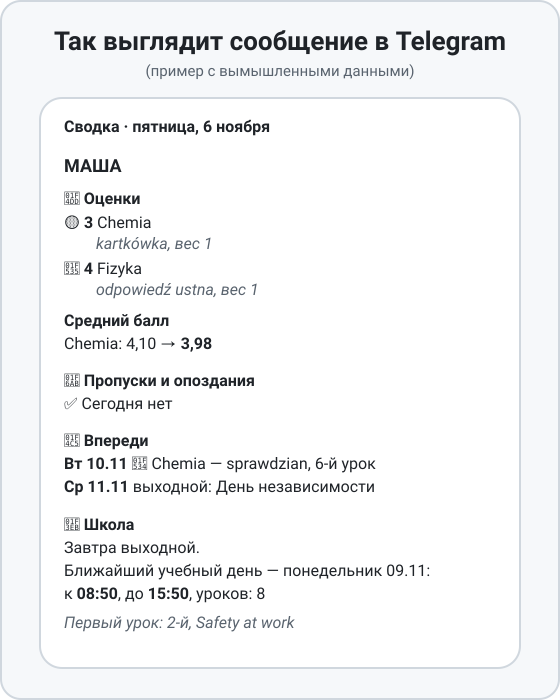
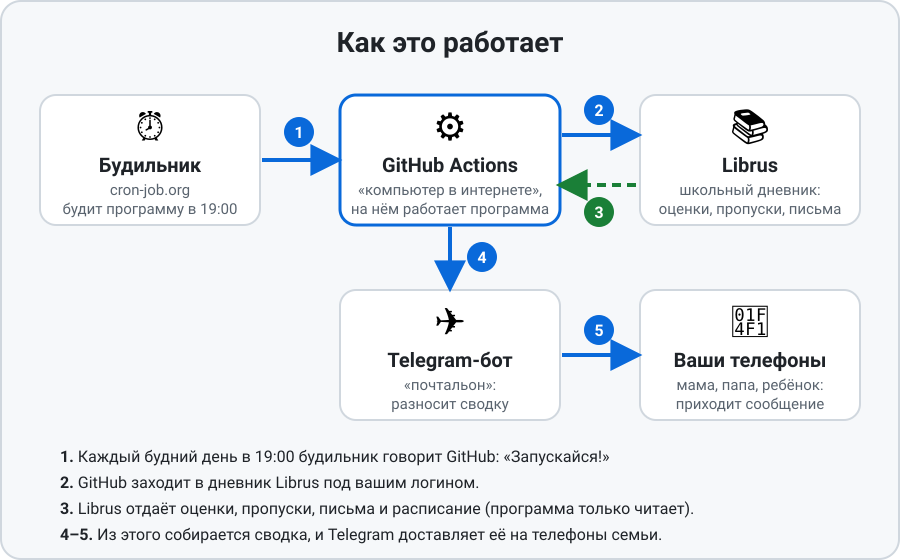

# Сводка из Librus в Telegram — инструкция для начинающих

Эта инструкция для тех, кто никогда не делал ничего подобного. Программировать не нужно:
всё делается мышкой и копированием. На всё уходит примерно **30–40 минут**, один раз.

**Что вы получите.** Каждый будний день в 19:00 в Telegram придёт сообщение:
оценки за день, пропуски, письма от учителей, что будет на этой неделе (контрольные,
выходные) и во сколько завтра в школу. Можно подключить несколько детей и несколько
получателей (мама, папа, ребёнок).

<p align="center">
  
</p>

**Что понадобится**
- Логин и пароль от Librus Synergia (цифровой логин, например `1234567`) для каждого ребёнка.
- Telegram на телефоне.
- Электронная почта (для регистрации на двух сайтах: GitHub и cron-job.org).
- Бесплатные аккаунты на GitHub и cron-job.org. Платить ничего не нужно.

> **Важно знать.** Это неофициальная программа, к Librus она отношения не имеет.
> Она заходит в дневник под вашим логином и только **читает** данные, ничего не меняет и
> не отправляет. Пользуйтесь ею только для своей семьи. Подробнее в английском
> [README](README.md), раздел «How it works and legal notes».

## Как это устроено, простыми словами

<p align="center">
  
</p>

1. **cron-job.org** — «будильник»: каждый будний день в 19:00 он говорит GitHub
   «запускайся».
2. **GitHub** — это «компьютер в интернете», на котором программа запускается бесплатно.
   Ваш компьютер включать не нужно. Он заходит в дневник Librus под вашим логином и
   забирает оценки, пропуски, письма и расписание. Программа только читает.
3. **Telegram-бот** — «почтальон»: GitHub отдаёт ему готовую сводку, а бот присылает её
   на телефоны всех, кого вы указали.

---

## Шаг 1. Создайте Telegram-бота

1. В Telegram найдите бота **@BotFather** (с синей галочкой) и нажмите **Start**.
2. Отправьте ему сообщение `/newbot`.
3. Он спросит название бота (любое, например `Школа`) и потом имя вида `что-то_bot`
   (должно заканчиваться на `bot` и быть свободным, например `MoiShkolaDnevnik_bot`).
4. В ответе вы увидите длинный **токен**, примерно такой: `123456789:AAH...`.
   Скопируйте его и сохраните в заметки. Это пароль от бота, никому его не показывайте.
5. Откройте ссылку на вашего бота (BotFather её пришлёт) и нажмите **Start**.
   **Каждый, кто будет получать сводку, тоже должен один раз нажать Start у этого бота.**
   Иначе бот не сможет ему писать.

## Шаг 2. Узнайте номер чата (кому слать)

Каждый получатель должен узнать свой номер:

1. В Telegram найдите бота **@userinfobot** и нажмите Start.
2. Он ответит сообщением, в котором есть строка **Id** с числом, например `123456789`.
3. Запишите это число. Если получателей несколько, запишите числа **через запятую
   без пробелов**: `123456789,987654321`.

## Шаг 3. Зарегистрируйтесь на GitHub и создайте свой репозиторий

*Репозиторий* — это просто «папка» в интернете, где лежит программа.

1. Откройте **github.com** и нажмите **Sign up**. Введите почту, придумайте пароль и имя
   пользователя (логин). Подтвердите почту.
2. Откройте страницу программы: **https://github.com/k30medvedev/librus-telegram-digest**.
3. Нажмите зелёную кнопку **Use this template** → **Create a new repository**.
   - Если такой кнопки нет, нажмите **Fork** (справа вверху) → **Create fork**.
4. Заполните:
   - **Repository name** — любое имя, например `librus-digest`.
   - Обязательно выберите **Private** (приватный). Так ваши данные никому не видны.
5. Нажмите **Create repository**.

Теперь у вас есть своя копия программы. Запомните свой логин на GitHub и имя репозитория:
они понадобятся в шаге 6.

> Если вы сделали **Fork**, откройте вкладку **Actions** и нажмите зелёную кнопку
> **I understand my workflows, go ahead and enable them**. Без этого ничего не запустится.

## Шаг 4. Добавьте секреты (пароли) и переменные (имена)

Это главный шаг: здесь вы «говорите» программе, чей дневник читать и кому писать.

**Секреты** — то, что нельзя показывать (пароли и токены). **Переменные** — безобидные
настройки (имена, язык).

Откройте ваш репозиторий → вкладка **Settings** (шестерёнка, справа вверху) → слева
**Secrets and variables** → **Actions**. Вы увидите две вкладки: **Secrets** и **Variables**.

### 4.1. Секреты

Откройте вкладку **Secrets** и для каждой строки таблицы нажмите зелёную кнопку
**New repository secret**: впишите **Name** (точно так, заглавными буквами) и
**Secret** (значение), затем **Add secret**.

| Name (имя) | Что вписать |
|---|---|
| `TELEGRAM_BOT_TOKEN` | токен из шага 1 |
| `TELEGRAM_CHAT_ID` | номер(а) чата из шага 2, через запятую без пробелов |
| `LIBRUS_1_LOGIN` | логин Librus первого ребёнка |
| `LIBRUS_1_PASSWORD` | пароль Librus первого ребёнка |
| `LIBRUS_2_LOGIN` | логин второго ребёнка (если есть) |
| `LIBRUS_2_PASSWORD` | пароль второго ребёнка (если есть) |

Для третьего и дальше ребёнка делайте так же: `LIBRUS_3_LOGIN`, `LIBRUS_3_PASSWORD`
(всего до пяти детей). Номера идут подряд, пропускать нельзя.

### 4.2. Переменные

Откройте вкладку **Variables** и для каждой строки нажмите **New repository variable**
(**Name** и **Value**, затем **Add variable**):

| Name | Значение | Зачем |
|---|---|---|
| `LIBRUS_1_NAME` | имя первого ребёнка, например `Маша` | так подписана сводка |
| `LIBRUS_2_NAME` | имя второго ребёнка | то же |
| `DIGEST_LANGUAGE` | `ru` | язык сводки: `ru` русский или `en` английский |
| `DIGEST_TIMEZONE` | `Europe/Warsaw` | ваш часовой пояс |

## Шаг 5. Проверьте, что всё работает

1. В репозитории откройте вкладку **Actions**.
2. Слева выберите **Librus digest**, справа нажмите **Run workflow** → зелёная кнопка
   **Run workflow**.
3. Подождите 1–2 минуты. Должна появиться строка с зелёной галочкой, а в Telegram
   придёт сводка. 🎉

Красный крестик? Откройте запись, нажмите на неё и посмотрите текст ошибки. Частые
причины описаны в разделе «Если что-то не работает» ниже.

## Шаг 6. Настройте «будильник» (каждый день в 19:00)

Сначала нужен специальный ключ для GitHub, чтобы «будильник» мог запускать программу.

### 6.1. Ключ (токен) GitHub

1. На GitHub нажмите на свою картинку профиля (справа вверху) → **Settings**.
2. Внизу слева: **Developer settings** → **Personal access tokens** → **Fine-grained tokens**
   → **Generate new token**.
3. Заполните:
   - **Token name**: `cronjob`.
   - **Expiration**: выберите срок, например 1 год (по его окончании ключ надо будет создать заново).
   - **Repository access**: выберите **Only select repositories** и укажите свой репозиторий.
   - **Permissions** → **Repository permissions** → найдите **Actions** и поставьте
     **Read and write**. **Больше ничего не меняйте и не добавляйте!**
4. Нажмите **Generate token** и **сразу скопируйте** ключ (начинается с `github_pat_`).
   Потом он больше не покажется. Сохраните его в заметки.

> Этот ключ — как пароль. Никому не присылайте его и не публикуйте.

### 6.2. Будильник на cron-job.org

1. Откройте **cron-job.org**, нажмите **Sign up** и зарегистрируйтесь (подтвердите почту).
2. В настройках аккаунта выберите часовой пояс, например **Europe/Warsaw**.
3. Нажмите **Create cronjob** («Создать cron задание»). Вкладка **Общее**:
   - **Заголовок**: `Librus digest`.
   - **URL** (подставьте свои данные вместо слов в скобках):
     ```
     https://api.github.com/repos/ВАШ-ЛОГИН-GITHUB/ИМЯ-РЕПОЗИТОРИЯ/actions/workflows/digest.yml/dispatches
     ```
     Например: `https://api.github.com/repos/masha123/librus-digest/actions/workflows/digest.yml/dispatches`
   - **График выполнения**: выберите **Пользовательское** и впишите в поле **Crontab
     выражение**:
     ```
     0 19 * * 1-5
     ```
     Это «каждый день в 19:00 с понедельника по пятницу». Если нужно и в воскресенье
     вечером (про понедельник), впишите `0 19 * * 0-5`. Справа в блоке «Следующий запуск»
     проверьте, что дни и время такие, как нужно.
4. Вкладка **Расширенное**:
   - **Метод запроса**: **POST**.
   - В блоке **Заголовки** нажмите **Добавить** и создайте 4 пары «Ключ — Значение»
     (скопируйте точно):

     | Ключ | Значение |
     |---|---|
     | `Authorization` | `Bearer ` (слово Bearer, пробел) и сразу за ним ваш ключ `github_pat_...` |
     | `Accept` | `application/vnd.github+json` |
     | `User-Agent` | `cronjob` |
     | `Content-Type` | `application/json` |

   - **Тело запроса**: `{"ref":"main"}`
5. Вкладка **Уведомления**: включите «запуск cron задания провален» — вам придёт письмо,
   если что-то сломается.
6. Нажмите **Тестовый запуск**. Должно быть написано **204 No Content** — это успех. В
   Telegram придёт сводка.
7. Нажмите **Создать**. Готово!

Теперь программа сама запускается каждый будний день в 19:00. Компьютер можно не включать.

---

## Если что-то не работает

| Что случилось | Что делать |
|---|---|
| В Telegram ничего не пришло, в Actions зелёная галочка | Получатель не нажал **Start** у вашего бота или в `TELEGRAM_CHAT_ID` неверный номер (шаг 2). Номера пишутся через запятую без пробелов |
| В Actions красный крестик, в тексте ошибки «Configuration error» | Не добавлен какой-то секрет. Проверьте названия: заглавные буквы, без пробелов (шаг 4) |
| Ошибка про логин или пароль Librus | Проверьте `LIBRUS_1_LOGIN` и `LIBRUS_1_PASSWORD`: войдите с ними на сайте Librus. Если вы меняли пароль, обновите секрет |
| Тестовый запуск на cron-job.org показывает **401** или **403** | Неверный ключ GitHub или у него нет права **Actions: Read and write** (шаг 6.1), или срок ключа истёк |
| На cron-job.org **404** | Опечатка в URL: проверьте логин GitHub и имя репозитория, они должны быть точными |
| Запуск на cron-job.org **204**, но в Telegram пусто | Откройте GitHub → Actions: там должна появиться запись. Если красная, смотрите ошибку внутри |
| Сводки перестали приходить | Проверьте, не истёк ли срок ключа GitHub (шаг 6.1), и не писал ли вам cron-job.org на почту. Иногда у самого GitHub бывают сбои: подождите час и запустите вручную (шаг 5) |
| Запуск на GitHub висит и отменяется через 10–15 минут, а сообщение про ошибку «no response from Librus» | Librus иногда не пускает серверы GitHub. Тогда запустите программу у себя дома на компьютере, а на cron-job.org отключите задание. Команды для Windows и Linux есть в английском [README](README.md), раздел «If Librus does not answer GitHub's servers» |
| Сводка на английском | Переменная `DIGEST_LANGUAGE` должна быть `ru` (шаг 4.2) |

## Частые вопросы

**Это безопасно?** Пароли хранятся в «секретах» GitHub: их не видно ни вам, ни другим
после сохранения, и они не попадают в журналы. Репозиторий должен быть **приватным**.
Сводка уходит в Telegram только тем номерам, которые вы указали.

**Бот прочитает мои письма в Librus?** Он открывает только сегодняшние письма, чтобы
показать начало текста. Из-за этого Librus отметит их прочитанными.

**Чьи данные видит бот?** Только тех детей, чьи логины вы указали. Пользуйтесь программой
только для своей семьи.

**Как добавить ещё одного получателя?** Он нажимает **Start** у вашего бота и узнаёт свой
номер у @userinfobot (шаг 2). Затем в секрете `TELEGRAM_CHAT_ID` (Settings → Secrets and
variables → Actions → нажмите на карандаш рядом с секретом) допишите его номер через запятую.

**Как добавить ещё одного ребёнка?** Добавьте секреты `LIBRUS_3_LOGIN`, `LIBRUS_3_PASSWORD`
и переменную `LIBRUS_3_NAME` (шаг 4).

**Как изменить время?** На cron-job.org откройте задание и поменяйте расписание
(например, `30 18 * * 1-5` — в 18:30).

**Сколько это стоит?** Нисколько: GitHub, cron-job.org и Telegram бесплатны для такого
использования.

**Как отключить?** Зайдите на cron-job.org и выключите задание или удалите его.
